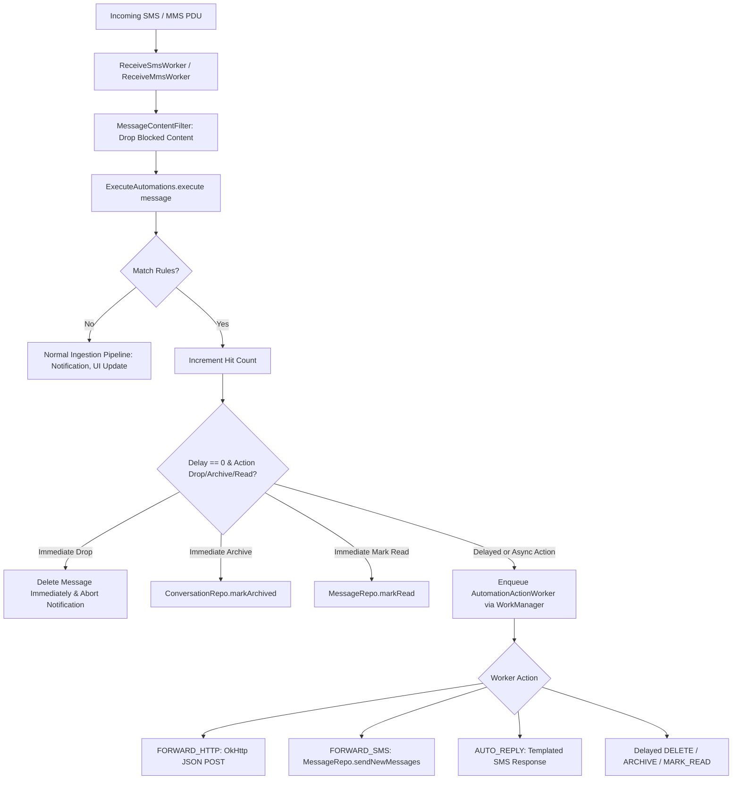

# QUIK (QKSMS Fork): Developer, Automation & Systems Operations Architecture Plan

> **Document Type**: Master Handoff Specification & System Architecture Guide  
> **Target Audience**: AI Coding Agents, Systems Developers, and Operations Engineers  
> **Project**: [QUIK](https://github.com/octoshrimpy/quik) (Private Fork: `limit-breaker-999/quik`)  
> **Current Version**: `v4.3.8` (versionCode `2240`)  
> **Target Android Platform**: SDK 34 (Android 14, 15, and Android 16 / Baklava Compatible)  
> **Last Updated**: 2026-10-06  

---

## 1. Executive Summary & Core Mission of this Fork

### 1.1 The Fork's Primary Intention
This codebase is **not just a consumer SMS messenger**. While it builds upon [QKSMS](https://github.com/moezbhatti/qksms) and [QUIK](https://github.com/octoshrimpy/quik), its specific architectural intention is to serve as an **autonomous edge messaging node for Developers, System Administrators, and DevOps Automation Operations**.

In modern operational workflows, physical Android devices or dedicated cellular modems serve as cellular endpoints (receiving 2FA OTPs, bank transaction notices, SIM carrier service alerts, server downtime notifications, emergency paging, and customer communication). 

This fork transforms the device into a programmable, rule-driven cellular operations engine capable of:
1. **Rule-Based Message Ingestion & Automation**: Intercepting incoming SMS/MMS at the lowest worker level and executing automated actions (drop, archive, mark read, relay, webhook post, auto-reply).
2. **HTTP Webhook Dispatching (`FORWARD_HTTP`)**: Forwarding incoming cellular payloads as JSON directly to external webhooks, incident management systems, or automation runners (n8n, Zapier, Slack, Discord, internal microservices).
3. **SMS Relaying (`FORWARD_SMS`)**: Auto-routing specific verification or emergency codes to other phone numbers with source attribution.
4. **Intelligent Auto-Replying (`AUTO_REPLY`)**: Autonomous template-based responders with rate-limiting and token interpolation (`{sender}`).
5. **System Management & Maintenance**: Message deduplication engines, scheduled auto-deletion, multi-SIM handling, and database maintenance utilities.
6. **Modern Google Pixel / Material 3 Admin UI**: When an operator physically interacts with the device, the UI provides a premier Google Messages-style Material 3 experience (pill search, squircle FABs, inset grouped settings cards, and fluid navigation).

---

## 2. Newly Added Automations & Dev-Ops Architecture

### 2.1 The Automations Pipeline Overview



### 2.2 Domain Model: `AutomationRule`
Location: [`domain/src/main/java/com/moez/QKSMS/model/AutomationRule.kt`](file:///home/ubuntu/quik/domain/src/main/java/com/moez/QKSMS/model/AutomationRule.kt)

| Field | Type | Description |
|---|---|---|
| `id` | `Long` (PrimaryKey) | Unique rule identifier. |
| `name` | `String` | Human-readable label (e.g. "Forward OTPs to Slack"). |
| `enabled` | `Boolean` | Master toggle for the rule. |
| `matchSender` | `String` | Sender pattern (exact substring or regex pattern). |
| `matchSenderIsRegex` | `Boolean` | Flag indicating regex evaluation for sender. |
| `matchSenderCaseSensitive` | `Boolean` | Case sensitivity flag for sender matching. |
| `matchBody` | `String` | Body pattern (exact substring or regex pattern). |
| `matchBodyIsRegex` | `Boolean` | Flag indicating regex evaluation for body. |
| `matchBodyCaseSensitive` | `Boolean` | Case sensitivity flag for body matching. |
| `skipContacts` | `Boolean` | If `true`, ignores messages from saved phone contacts. |
| `action` | `String` | One of `DELETE`, `ARCHIVE`, `MARK_READ`, `FORWARD_SMS`, `FORWARD_HTTP`, `AUTO_REPLY`. |
| `forwardToPhone` | `String` | Target phone number for `FORWARD_SMS`. |
| `forwardToUrl` | `String` | Target HTTP(S) endpoint URL for `FORWARD_HTTP`. |
| `appendSenderToForward` | `Boolean` | Prepends `"From: <sender> \| "` to forward payload. |
| `replyTemplate` | `String` | Template for `AUTO_REPLY`, supports `{sender}` placeholder. |
| `replyRateLimitMs` | `Long` | Rate-limiting interval between replies to the same thread (default: 24h). |
| `delayMs` | `Long` | Milliseconds to delay action execution (0 = immediate, 30s, 1m, 5m, 1h). |
| `createdAt` | `Long` | Timestamp of rule creation. |
| `hitCount` | `Long` | Execution counter tracking how many times the rule fired. |

### 2.3 Automation Interactor: `ExecuteAutomations`
Location: [`domain/src/main/java/com/moez/QKSMS/interactor/ExecuteAutomations.kt`](file:///home/ubuntu/quik/domain/src/main/java/com/moez/QKSMS/interactor/ExecuteAutomations.kt)
- **Evaluation Loop**: Queries `AutomationRuleRepository.getEnabledRules()`.
- **Filtering**: Evaluates `skipContacts` against `ContactRepository.isContact(address)`.
- **Regex Safety**: Wraps regex parsing in `try-catch` blocks to prevent crash loops from invalid user-entered regular expressions.
- **Immediate vs Delayed Execution**:
  - `DELETE` with `delayMs == 0` deletes the message record from Realm immediately and returns `ExecutionResult.Dropped`, halting notification generation in `ReceiveSmsWorker`.
  - `ARCHIVE` and `MARK_READ` with `delayMs == 0` execute synchronously on repositories.
  - All other actions (or rules with `delayMs > 0`) build a `Data` payload and enqueue a `OneTimeWorkRequest` for `AutomationActionWorker` with `setInitialDelay()`.

### 2.4 Background Action Worker: `AutomationActionWorker`
Location: [`data/src/main/java/com/moez/QKSMS/worker/AutomationActionWorker.kt`](file:///home/ubuntu/quik/data/src/main/java/com/moez/QKSMS/worker/AutomationActionWorker.kt)
- **WorkManager Architecture**: Executed by Android's `WorkManager` via custom `InjectionWorkerFactory`.
- **HTTP Forwarding**: Dispatches JSON payload using `OkHttpClient`:
  ```json
  {
    "from": "+15550199",
    "body": "Your server alert: CPU > 95%",
    "timestamp": 1728240000000
  }
  ```
- **SMS Forwarding**: Calls `messageRepo.sendNewMessages(-1, listOf(phone), body, emptyList(), false)`.
- **Auto-Reply**: Replaces `{sender}` token in template and fires automated SMS back to sender.

### 2.5 Admin UI: Automations Management
- **Main Rules Screen**: [`AutomationsController.kt`](file:///home/ubuntu/quik/presentation/src/main/java/com/moez/QKSMS/feature/settings/automations/AutomationsController.kt)
  - Displays rule list with enable/disable toggles, rule hit counts, action tags, and FAB for adding rules.
- **Rule Editor**: [`EditAutomationController.kt`](file:///home/ubuntu/quik/presentation/src/main/java/com/moez/QKSMS/feature/settings/automations/edit/EditAutomationController.kt)
  - Full configuration for triggers (sender, body, regex toggles, case sensitivity, contact bypass).
  - Mutually exclusive RadioGroup for actions (`Delete`, `Archive`, `Mark Read`, `Forward SMS`, `Forward HTTP`, `Auto-Reply`).
  - Interactive chip delay selector (`0s`, `30s`, `1m`, `5m`, `1h`).
  - **Curated Regex Presets**: Built-in library for instant operational setup:
    - `OTP (generic)`: `(?i)\b\d{4,8}\b`
    - `OTP senders (IN)`: `^[A-Z]{2}-[A-Z0-9]{2,6}OTP`
    - `Bank alert`: `(?i)\b(debited|credited|balance|INR|transaction)\b`
    - `Promo / marketing`: `(?i)\b(offer|sale|% off|limited time|promo|coupon|subscribe)\b`
    - `URL-only spam`: `^https?://\S+$`
    - `Delivery / shipment`: `(?i)\b(out for delivery|delivered|shipment|AWB|consignment|tracking)\b`
    - `Flight / travel`: `(?i)\b(PNR|boarding|flight|departure|check-in)\b`

### 2.6 Message Operations Utilities
Location: [`presentation/src/main/java/com/moez/QKSMS/feature/messageutils/MessageUtilsController.kt`](file:///home/ubuntu/quik/presentation/src/main/java/com/moez/QKSMS/feature/messageutils/MessageUtilsController.kt)
- **Message Deduplication Engine**: Scans telephony and local database for duplicate SMS messages (common during device syncs or gateway retries) with progress tracking.
- **Auto-Delete Lifecycle**: Configurable retention thresholds (never, 30 days, 90 days, 1 year) with bulk cleanup warnings.

---

## 3. Project Architecture & File Structure

The project is structured as a multi-module Gradle project following Clean Architecture + MVP/MVI patterns:

```
quik/
├── android-smsmms/             # Klinker Telephony MMS/SMS low-level APN & PDU stack
├── common/                     # Cross-module extensions, base views, shared utilities
│   └── src/main/java/com/moez/QKSMS/common/
│       ├── base/               # QkActivity, QkThemedActivity, QkController, QkPresenter
│       ├── util/               # Colors, DateFormatter, PhoneNumberUtils, Extensions
│       └── widget/             # QkTextView, QkEditText, PreferenceView, AvatarView, QkSwitch
├── data/                       # Concrete data layer, persistence, system managers, workers
│   └── src/main/java/com/moez/QKSMS/
│       ├── manager/            # NotificationManager, ShortcutManager, ActiveConversationManager
│       ├── migration/          # QkRealmMigration (Realm schema migrations)
│       ├── repository/         # Realm repository implementations (AutomationRuleRepositoryImpl, etc.)
│       └── worker/             # WorkManager workers (ReceiveSmsWorker, ReceiveMmsWorker, AutomationActionWorker, InjectionWorkerFactory)
├── domain/                     # Pure business logic, interfaces, and domain models
│   └── src/main/java/com/moez/QKSMS/
│       ├── interactor/         # ExecuteAutomations, UpdateBadge, MarkRead, etc.
│       ├── model/              # AutomationRule, Conversation, Message, Recipient
│       └── repository/         # Repository interfaces (AutomationRuleRepository, MessageRepository, etc.)
└── presentation/               # Android UI layer: Conductor Controllers, Activities, ViewModels, Layouts, Resources
    └── src/main/
        ├── AndroidManifest.xml # Declarations, permissions, foreground services
        ├── java/com/moez/QKSMS/
        │   ├── common/widget/  # UI Widgets (AvatarView, QkSwitch, GroupAvatarView)
        │   ├── feature/
        │   │   ├── main/       # MainActivity, MainViewModel, ConversationsAdapter (Messages home screen)
        │   │   ├── compose/    # ComposeActivity, message part binders
        │   │   ├── settings/   # SettingsController, SettingsPresenter
        │   │   │   └── automations/ # AutomationsController, EditAutomationController, rules adapter
        │   │   ├── messageutils/# MessageUtilsController, deduplication & retention
        │   │   ├── blocking/   # BlockingActivity, blocked conversation management
        │   │   └── backup/     # BackupActivity, import/export SMS/MMS
        └── res/
            ├── layout/         # XML layouts (main_activity, drawer_view, settings_controller, automations_controller, etc.)
            ├── values/         # themes.xml, colors.xml, styles.xml, attrs.xml, strings.xml
            └── values-night/   # Dark mode themes.xml
```

---

## 4. Git Branch Strategy & Detailed Branch Status

### 4.1 Git Branch Matrix

```
* feature/material3-redesign-v2   --> ACTIVE DEVELOPMENT & BUGFIX BRANCH (M3 Google Pixel Theme)
  master (origin/master)         --> BASE AUTOMATIONS WORKING BRANCH (Commit 2367b172)
  feature/modern-ui-redesign     --> HISTORICAL BRANCH (iOS Translucency Experiment)
  upstream/master                --> UPSTREAM TRACKING
```

### 4.2 Branch 1: `master` (`2367b172`)
- **Key Commit**: `2367b172 - feat(automations): add comprehensive SMS/MMS automation engine with settings UI and Android 16 compatibility`
- **What it Contains**:
  - Entire backend automation engine (`AutomationRule`, `ExecuteAutomations`, `AutomationActionWorker`).
  - WorkManager hooks in `ReceiveSmsWorker` and `ReceiveMmsWorker`.
  - Android 16 SDK 34 compatibility updates (foreground service types `dataSync` and `specialUse`).
  - Automations UI (`AutomationsController`, `EditAutomationController`).
- **CRITICAL STATUS & WARNING FOR INCOMING AGENT**:
  > [!WARNING]
  > The user has **explicitly stated** that while the automation features are committed into the base codebase, **they have NOT yet been end-to-end verified or battle-tested in real runtime execution**. You must treat the automations engine as unverified code that requires thorough testing, edge-case analysis, and bug hunting!

### 4.3 Branch 2: `feature/material3-redesign-v2` (Current Working Branch)
- **Key Commit**: `8141a85c - feat(ui): Material 3 Expressive redesign and bump version to v4.3.8`
- **Design Objective**: Emulate modern **Google Pixel system apps (Google Messages aesthetic)**:
  - Material 3 tokens: Porcelain (`#F8FAFC`), Midnight Obsidian (`#0B0F19`), and AMOLED Pure Black (`#000000`).
  - Pill search bar: 48dp height, 24dp corner radius, centered search icon.
  - Large title header: 22sp bold "Messages" styling.
  - Squircle FAB: 16dp rounded corners with theme color background.
  - Full-width conversation list: edge-to-edge layout, Glide contact photo loading, high-contrast fallback initials.
  - Inset Grouped Settings: 16dp rounded `MaterialCardView` cards with inset dividers.
  - Upgraded to Material Components `1.12.0`.
- **Working Tree Changes (Bugfixes Applied & Tested)**:
  1. **Fixed Sub-Screen Crashes (ThemeEnforcement)**:
     - `AppBaseTheme` previously inherited from `Theme.AppCompat.Light.NoActionBar` / `Theme.AppCompat.NoActionBar`.
     - When opening Settings, Blocked List, or Automations, `MaterialCardView` and `MaterialSwitch` crashed with `IllegalArgumentException: The style on this component requires your app theme to be Theme.MaterialComponents`.
     - Fixed `presentation/src/main/res/values/themes.xml` and `values-night/themes.xml` to inherit from `Theme.MaterialComponents.Light.NoActionBar` / `Theme.MaterialComponents.NoActionBar`.
  2. **Defensive `QkSwitch` Wrapping**:
     - Wrapped constructor context in `MaterialThemeOverlay.wrap(context, attrs, defStyleAttr, Widget_Material3_CompoundButton_MaterialSwitch)`.
     - Guarded tint list resolution with `try-catch` to prevent any context theming crash.
  3. **Fixed Drawer Sliding & Gliding Bugs in `MainActivity.kt`**:
     - Connected `binding.drawerLayout.addDrawerListener(toggle)` so the toggle tracks glide offsets.
     - Registered custom toolbar navigation click handler: smoothly opens/closes drawer when indicator is enabled, routes to `homeIntent` when back arrow is showing (selection/search mode).
     - Removed touch-stealing `binding.drawer.root.clicks()` on the drawer ScrollView; added `clickable="true"` and `focusable="true"` natively in `drawer_view.xml`.
     - Removed `binding.toolbarSearch.requestFocus()` from `drawerToggled(false)` so closing the drawer no longer causes soft-keyboard popups or glide stutters.
     - Prevented `openDrawer` snap-back during active swipe-to-close gestures.

---

## 5. Explicit Directives for the Incoming Agent: Bug Hunting & Hardening

As the next agent picking up this work, you must execute a thorough inspection and hardening pass across the entire app. Focus specifically on the following areas:

### 5.1 🚨 Thorough Crash & Theme Enforcement Audit
- **Examine all Activities & Dialogs**:
  - `SettingsActivity`, `BlockingActivity`, `BackupActivity`, `PlusActivity`, `ConversationInfoActivity`, `GalleryActivity`.
  - Check whether any dialog layout or ViewStub uses Material 3 / MaterialComponents views while running in an un-themed context.
  - Verify `AppThemeDialog` and `AppThemeDialog.Black` in dialog controllers (`TextInputDialog`, `BlockingDialog`, `ChangelogDialog`, `AutoDeleteDialog`).
- **Check Realm Migrations**:
  - In [`data/src/main/java/com/moez/QKSMS/migration/QkRealmMigration.kt`](file:///home/ubuntu/quik/data/src/main/java/com/moez/QKSMS/migration/QkRealmMigration.kt), ensure schema bump to version 25 (or current schema version) properly handles existing user databases without dropping columns or throwing `RealmMigrationNeededException`.

### 5.2 🔍 Unclickable Buttons & Dead Touch Handlers
- **Conductor Router Click Propagation**:
  - Conductor controllers manage views independently from Android Fragments.
  - In [`SettingsController.kt`](file:///home/ubuntu/quik/presentation/src/main/java/com/moez/QKSMS/feature/settings/SettingsController.kt), verify that the recursive `findPreferences(view: View)` function reaches every preference item enclosed within nested `MaterialCardView` or `LinearLayout` containers.
  - In [`AutomationsController.kt`](file:///home/ubuntu/quik/presentation/src/main/java/com/moez/QKSMS/feature/settings/automations/AutomationsController.kt), verify that rule item click listeners (`editClicks`, `deleteClicks`, `toggleClicks`) in `AutomationRulesAdapter` emit on the correct Rx subjects.
  - In [`EditAutomationController.kt`](file:///home/ubuntu/quik/presentation/src/main/java/com/moez/QKSMS/feature/settings/automations/edit/EditAutomationController.kt):
    - Check that `binding.actionGroup.setOnCheckedChangeListener` correctly handles radio clicks without re-entrant trigger loops.
    - Check that delay chips (`delayNone`, `delay30s`, `delay1m`, `delay5m`, `delay1h`) update `delaySubject` and reflect visually in `binding.delaySummary`.
    - Check that `binding.presetsButton` shows the presets dialog and populates `matchBodyField` and `bodyRegexSwitch`.

### 5.3 ⚡ Action Sequence Mismatches & Concurrency Glitches
- **WorkManager & Dagger Injection in Background**:
  - In [`InjectionWorkerFactory.kt`](file:///home/ubuntu/quik/data/src/main/java/com/moez/QKSMS/worker/InjectionWorkerFactory.kt), verify that when Android launches `AutomationActionWorker` out-of-process or after the app process was killed, all dependencies (`messageRepo`, `conversationRepo`, `notificationManager`) are non-null and injected.
  - Check if `AutomationActionWorker` runs into Realm threading errors. **Remember**: Realm objects cannot be passed across threads. `AutomationActionWorker` must only receive primitive IDs (`messageId`, `threadId`) in `inputData` and query Realm on its own background thread.
- **Presenter Subscriptions & Memory Leaks**:
  - Audit all RxJava subscriptions in `AutomationsPresenter` and `EditAutomationPresenter` to verify they use `.autoDisposable(view.scope())` and do not leak when controllers are popped or detached.
- **State Machine Re-entrancy**:
  - In `EditAutomationController.render(state)`: verify that updating text fields (`ruleName.setText(...)`) does not trigger infinite loops with `nameChanges().textChanges()`. Ensure checks like `if (text.toString() != state.name)` protect all inputs.

### 5.4 🌐 Dev Operations & Edge Automation Verification
- **HTTP Webhook Execution (`FORWARD_HTTP`)**:
  - In `AutomationActionWorker`:
    - Check OkHttp call timeouts (must specify explicit connect/read timeouts so a slow webhook does not hang the worker).
    - Check Android Network Security Config: Ensure cleartext HTTP is allowed if developers send webhooks to local IP addresses (e.g., `http://192.168.1.100:5678/webhook`).
    - Verify JSON quoting: Check that special characters or multiline SMS text in `messageBody` do not break JSON syntax (currently using `JSONObject.quote(messageBody)`).
- **SMS Relaying (`FORWARD_SMS`)**:
  - Verify that forwarding handles multi-SIM devices: When relaying, does `messageRepo.sendNewMessages()` pick the default SMS subscription ID without crashing?
- **Auto-Reply Safety**:
  - Verify loop prevention: If an incoming message was sent by an automated system, verify that auto-replies don't bounce back and forth indefinitely. Check if `replyRateLimitMs` is strictly enforced per thread.

### 5.5 🎨 Color Schemes & Palette Harmonization (M3 Tonal Roles)
- **Current Limitation**:
  - The app's theme picker and contact random coloring engine still use legacy 2014 Material 1 saturated hex arrays (`R.array.material_red`, etc.).
  - Legacy accent colors are applied directly to backgrounds without modern HCT (Hue, Chroma, Tone) role derivation.
- **Recommended Next Step**:
  - Integrate Material 3 Dynamic Color / Tonal Palettes. When a seed color is chosen, generate standard M3 tonal roles (`primaryContainer`, `onPrimaryContainer`, `surfaceVariant`, `outline`).

---

## 6. Build, Verification & Deployment Runbook

### 6.1 Compiling Kotlin Sources
To verify that all Kotlin code, view bindings, and Dagger injections compile with 0 errors:
```bash
./gradlew compileReleaseKotlin
```

### 6.2 Assembling the Signed Release APK
To assemble the full release APK (configured with v1, v2, v3, and v4 signing schemes):
```bash
./gradlew assembleRelease
```
The output APK is generated at:
`presentation/build/outputs/apk/release/QUIK-v4.3.8-release.apk`

### 6.3 Deploying to Test Host via Tailscale
The developer environment is connected to the user's Windows test machine (`sirius`, IP `100.114.245.21`).
To transfer the compiled build to the test device:
```bash
tailscale file cp presentation/build/outputs/apk/release/QUIK-v4.3.8-release.apk sirius:
```

---

## 7. Immediate Checklist for the Incoming Agent

1. [ ] Read this `plan.md` in full.
2. [ ] Check current `git status` on `feature/material3-redesign-v2` to confirm the working tree is intact.
3. [ ] Run `./gradlew compileReleaseKotlin` to confirm a green baseline build.
4. [ ] Perform static code audit on `AutomationActionWorker.kt`, `ExecuteAutomations.kt`, and `InjectionWorkerFactory.kt` for null safety and Realm thread isolation.
5. [ ] Audit `EditAutomationController.kt` and `AutomationsController.kt` for clickability and UI state preservation.
6. [ ] Test / verify network security permissions in `AndroidManifest.xml` for webhook forwarding.
7. [ ] Document all discovered bugs, apply surgical fixes, recompile, and generate a new verification build.
